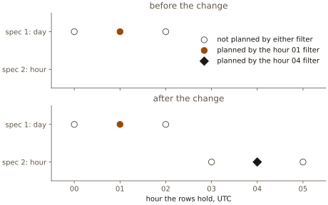

# Change partitioning without rewriting old files

Here you change the partitioning of a table in Iceberg, Delta Lake and DuckLake, and count the files a query plans before and after the change. Partitioning decides which files a query opens, so a change to it changes what every reader pays. What it does to the files already written depends on the format.

`wiki.pageviews_hourly`, whose dashboards read one hour at a time, is partitioned by day, and the question is how to regroup it by hour without rewriting what has been loaded. The [three hourly loads](#append-each-hour) from the start are already on disk. So the team wants hour partitions for every load after hour 02, and it needs to know what the change does to the three loads that exist, without copying them.

The change has two costs. The first is the work to make it, which depends on whether the format leaves old files alone. The second is what every later query pays, since a query that spans the change plans files from both eras. This chapter measures both with counts from each library, so the decision rests on what the tables do rather than on a description of the format.

## Partition specs are versioned too {#partition-specs-are-versioned}

A partition spec says how a table groups its rows, for example one group per day of `hour_utc`. In Iceberg the spec is part of the table's metadata, and the manifest that lists each data file records the spec that file was written under. Changing the spec makes a second spec with its own ID. Later writes use the second spec, and the files already on disk keep the spec they were written under. The [Iceberg specification](https://iceberg.apache.org/spec/) says that a changed spec is added to the table's list of partition specs under a unique spec ID, and that each manifest records the ID of the spec used to write it (`partition_spec_id`).

That gives the table two partitioning eras side by side. A query reads the spec of each file it opens, so one scan can cover files under several specs. The planner does this for you, so the cost of the change shows up in the plan and the file counts, not in the rows the query returns. A query written against `hour_utc` keeps its text when the spec changes, which is the point of the design. What differs is the set of files the planner opens. The rest of this chapter shows both.

The spec change is metadata only. Iceberg writes a spec with its own ID and leaves the data files alone, as the file counts in [the next section](#files-written-under-each-spec) show.

The old spec also stays in place as history. The table keeps a record of every spec it has had, so a reader can always find out which fields a file was written under. This matters for a team that changes partitioning more than once: each file answers the question "how was I split?" with its own spec, and nobody has to remember the order of the changes. The record is metadata, so it costs little, but the table's list of specs grows with each change.

The other two formats handle partitioning differently, and the differences decide what a change costs. Delta Lake takes its partition columns by name, so the writer creates them as columns. DuckLake keeps its partitioning keys in its catalog. Each has its own part in [the section on the other formats](#partitioning-in-other-formats), after the Iceberg steps that the rest of the chapter depends on.

**Working rule:** Change an Iceberg partition spec when your readers' filters change and the current spec plans too many files for them. If the current spec already plans few files for those filters, leave it alone. When you do change it, leave the old files where they are. Record the change, with the date, the old and replacement fields, and the readers' filters that prompted it, in the table's runbook. Keep the plan counts from before and after the change with it, as [the section on what a query scans](#check-what-a-query-scans) shows.

## Move from daily to hourly partitions {#daily-to-hourly-partitions}

Each example builds its table from [the cut](../examples/data/README.md) again, with the original columns and not the ones [chapter 3](#columns-tracked-by-id) added. To move the table to hours, you swap one transform of `hour_utc` for another. Iceberg partitions by a transform of a column: the day transform puts each row under its calendar day, and the hour transform puts each row under its hour. The pyiceberg library computes these transforms with the `pyiceberg-core` package, and the day transform imports that package when it writes. An install with only `pyiceberg` therefore fails at the first append under a day or hour partition (pyiceberg {{version:pyiceberg}} source, [`pyiceberg/transforms.py`](https://raw.githubusercontent.com/apache/iceberg-python/pyiceberg-0.12.0/pyiceberg/transforms.py), `DayTransform.pyarrow_transform`). The pins in this book include `pyiceberg-core` at {{version:pyiceberg-core}}, next to `pyiceberg` at {{version:pyiceberg}}.

The table starts with a day spec. Hours 00 to 02 load under it. Then the spec changes, and hours 03 to 05 load under the hour spec. The change is one `update_spec()` block that removes the day field and adds the hour field:

```python
with table.update_spec() as update:
    update.remove_field("ts_day")
    update.add_field("hour_utc", HourTransform(), "ts_hour")
```

Both calls go in one block, so the table gets one spec change with the day field gone. The spec list, printed in order with the transform of each field, shows what the change did. The field names are the ones this book uses, `ts_day` and `ts_hour`, so a spec label says which transform each field applies. The source column stays `hour_utc`. The day field and the hour field are two transforms of that column, so a reader's filter on the column keeps working across both eras.

[Example: day-then-hour-spec](../examples/day-then-hour-spec.py)

Read the output from the top. Spec 1 has one field, `ts_day`, with the day transform. Spec 2 has one field, `ts_hour`, with the hour transform. The table's rows are all there after the change: `{{out:day-then-hour-spec:rows in table}}` rows, which is the three hours before the change and the three after it.

The spec change is the only step that touches the metadata alone. The loads on either side of it write data files as usual, and [the next subsection](#files-written-under-each-spec) shows which spec each file belongs to.

A mistake here shows up later, not in the change itself. If the spec list is wrong, every load after the change writes files under the wrong partitioning, and the counts in the next section are the first place you see it. Checking the spec list right after the change costs one line of output and saves a rewrite.

**Working rule:** In Iceberg, make the spec change in one `update_spec()` block, so the old field is removed in the same change that adds the replacement. Split the two edits only if a step has to run between them; this chapter has no such step. Check the spec list after the change, and check that the field names and transforms are the ones you meant before you load any data under the second spec.

### Files written under each spec {#files-written-under-each-spec}

Each data file belongs to the spec it was written under, so counting files by spec tells you which era each file is from. The listing of data files carries each file's spec ID, so the count can group the files by spec, one count per spec under the labels "spec 1" and "spec 2". The labels number the specs in the order they were made, so the output names no spec ID.

The three day-partitioned loads kept their files through the change. The output shows `{{out:day-then-hour-spec:spec 1 data files}}` data files under spec 1 and `{{out:day-then-hour-spec:spec 2 data files}}` under spec 2, so the three hour-partitioned loads wrote their own, and the spec change itself wrote nothing. If the count under spec 1 had dropped after the change, something would have rewritten those files, and you would need to find out what before you trusted the old era's data.

**Working rule:** After any spec change, count the data files under each spec and compare the counts with the loads you made. A count that moves when no rewrite was planned means the change did more than you wanted, so stop and check before the next load.

## Check what a query scans {#check-what-a-query-scans}

A [partition spec](#partition-specs-are-versioned) is a way to skip files. Before a query reads a file, the planner looks at the file's partition values and its column bounds, and drops files that cannot match the filter. Your query is only as cheap as the files it does not plan. So the way to check a change is to count the files a typical filter plans, before and after the change, rather than to compare the rows. Planning a scan returns the list of files without reading their rows, so the count is cheap enough to run before every change.

Pruning is where the change pays off, so plan three scans twice: once under the day spec (see [moving to hourly partitions](#daily-to-hourly-partitions)), and again after the three hour-partitioned loads. Two filters each ask for one hour: hour 01, which was loaded before the change, and hour 04, which was loaded after it. The third has no filter and is a full scan.

[Example: plan-files-by-partition](../examples/plan-files-by-partition.py)

| Stage | One-hour filter | Hour 04 filter | No filter |
| --- | --- | --- | --- |
| Before the change, three day-partitioned loads | {{out:plan-files-by-partition:before the change, one-hour filter plans}} | {{out:plan-files-by-partition:before the change, hour 04 filter plans}} | {{out:plan-files-by-partition:before the change, no filter plans}} |
| After the change, three hour-partitioned loads added | {{out:plan-files-by-partition:after the change, one-hour filter plans}} | {{out:plan-files-by-partition:after the change, hour 04 filter plans}} | {{out:plan-files-by-partition:after the change, no filter plans}} |

Each filter reaches the file of its own hour, in whichever era that hour was loaded. The one-hour filter plans {{out:plan-files-by-partition:before the change, one-hour filter plans}} file before the change and {{out:plan-files-by-partition:after the change, one-hour filter plans}} file after it, and the hour 04 filter plans {{out:plan-files-by-partition:before the change, hour 04 filter plans}} files before and {{out:plan-files-by-partition:after the change, hour 04 filter plans}} file after. Hour 01 was loaded before the change, so the one file in both plans is that hour's day-partitioned file. Before the change, all three files share one day, so the planner can skip the other two only by their `hour_utc` bounds. After the change, the three hour-partitioned files are skipped as well. Hour 04 runs the other way. No day-partitioned file holds it, so its only match is the hour-partitioned file that holds that hour. The counts do not show whether the planner skipped a file on its partition values or on its column bounds; they show only what the plan kept.

{{fig:files-by-spec}} plans every one-hour filter after the change, not only the two in the table, and marks the spec of the one file each plans. The hour 01 filter's file is under {{out:figure-files-by-spec:hour 01 filter plans a file under}}, the day spec, and the hour 04 filter's is under {{out:figure-files-by-spec:hour 04 filter plans a file under}}, the hour spec: old files and new answer the same filter side by side.



[Example: figure-files-by-spec](../examples/figure-files-by-spec.py)

A plan count is a count of files, not of bytes. Two plans with the same count can read different amounts of data, because files differ in size. The count is still the right first check, because it is the number the planner decides on. When the counts agree and the query is still slow, look at file sizes and at the query itself.

A full scan pays for every file the table has written. Its plan grows from {{out:plan-files-by-partition:before the change, no filter plans}} files to {{out:plan-files-by-partition:after the change, no filter plans}}, the day-partitioned files plus the hour-partitioned ones. That growth is the cost of keeping old files in place, and it is the reason to count the full scan as well as the filtered ones.

**Working rule:** Plan the filters your readers use, and the full scan, before and after every partition change, and keep the counts with the runbook entry. If a filter that planned one file starts to plan many, the change has broken the pruning for that filter, and you should change the spec or the filter before the next load under it.

## Partitioning in the other formats {#partitioning-in-other-formats}

In the other two formats the same change costs something different, though the rows read back are the same in all three. The files and the plan are what change. The table below sums up the three.

| Format | How the change is made | Files already written | What to check after |
| --- | --- | --- | --- |
| Iceberg | One `update_spec()` block | Kept, and still under their old spec | File count per spec; plan counts |
| Delta Lake | Full overwrite with `schema_mode="overwrite"` | Written again in a later version; old version kept | Row count; file count; partition columns of the old version |
| DuckLake | `ALTER TABLE ... SET PARTITIONED BY` | Kept; the setting applies to later loads | File count after one load; the partition key |

**Delta Lake** partitions by plain columns, and its partition option takes column names, not expressions. The Delta Lake protocol defines `partitionColumns` as [an array containing the names of columns](https://raw.githubusercontent.com/delta-io/delta/v4.4.1/PROTOCOL.md) by which the data is partitioned. A generated column can compute `day` or `hour` inside the table, but it raises the table's writer protocol, so this book computes both in the writer. A helper, `with_partition_columns`, adds the two string columns from `hour_utc` before each write. The table starts partitioned by `day`, and a change to `hour` is refused unless the write is a full overwrite that also replaces the schema:

```
DeltaError: Generic error: Specified table partitioning does not match table partitioning: expected: ["day"], got: ["hour"]. To change partition columns, use full table overwrite with schema overwrite and no replaceWhere predicate.
```

Try the change with a plain `mode="overwrite"` first, and the library refuses it with that error. The same write with `schema_mode="overwrite"` then goes through. That is the setting the library's API at the pins uses in place of the older `overwrite_schema` flag. The rows are read into memory before the overwrite starts, because an overwrite replaces every row the table holds. Writing the rows back is the only way to keep them.

[Example: delta-partition-overwrite](../examples/delta-partition-overwrite.py)

The rewrite moves the table to a new version and keeps its rows. The three loads are versions 0 to 2, so the table is at version {{out:delta-partition-overwrite:version before}} before the change and {{out:delta-partition-overwrite:version after}} after the rewrite.

The new version holds the same {{out:delta-partition-overwrite:rows after}} rows in {{out:delta-partition-overwrite:data files after}} files, one for each hour partition, which matches the three hours. Version {{out:delta-partition-overwrite:version before}} still reads back through `read_delta`, with its `day` partition and {{out:delta-partition-overwrite:rows in version 2}} rows.

The Delta change is a rewrite of the table's current files, not a metadata edit. The table here is small. A large table needs the same rewrite at its own cost, so plan it as a maintenance task with a read window. Every row is also read into memory before the write, so the rewrite needs room for the whole table at once. For a table that does not fit, a copy into a new location is the safer route, and [chapter 9](#check-copy-with-digest) shows how to check such a copy.

**DuckLake** stores partitioning as a table setting in its catalog, and a change applies to later loads only. The [DuckLake documentation](https://ducklake.select/docs/stable/duckdb/advanced_features/partitioning) says the partitioning keys of a table affect only the data written after the change. Set the table to partition by `hour(hour_utc)`, load one more hour, and the file counts before and after that load show the rule at work. The helper attaches the catalog with inlining off, so each load writes a data file, and the count shows what each load did.

[Example: ducklake-partition-alter](../examples/ducklake-partition-alter.py)

The table had {{out:ducklake-partition-alter:data files before the change}} data files before the hour load and {{out:ducklake-partition-alter:data files after one load under hour}} after it, so the hour load wrote one file. Of the files listed after that load, {{out:ducklake-partition-alter:files kept from before the change}} were already listed before it. The three earlier loads were not rewritten, which is what the documentation's rule means in practice. The catalog lists one partition key, with the transform `hour`, and the table holds {{out:ducklake-partition-alter:rows in table}} rows.

**Working rule:** In Iceberg and DuckLake, a partition change is a change to metadata. Old files stay in place and later loads use the partitioning the change set, so check the file counts after the first load. In Delta Lake, a partition change is a full overwrite that rewrites the table's current files, so plan it as a rewrite and check the row count and the file count after it.

## What goes wrong in production {#partition-production-failures}

A partition change rarely fails at the change itself; the trouble shows up in later loads and plans.

Start with a missing package. At the pins set out in [the section on moving to hourly partitions](#daily-to-hourly-partitions), the day and hour transforms need `pyiceberg-core`, and the transforms import it when they write. An environment that installs only `pyiceberg` can create the table and then fails at the first append under a time transform. It surfaces at the first scheduled load, not when the spec is changed, which is why the pin belongs in the requirements file and not in someone's memory of the install.

Over-partitioning comes next. A partition grain finer than the filters need gives each query more files to open, and each file holds fewer rows. Hourly loads of a few hundred rows each give files that are small in absolute terms. This is a rule of thumb, not a measurement: the cost depends on your storage and your engine. The plan count in [the section on what a query scans](#check-what-a-query-scans) shows how many files a query opens under each spec. The full-scan count that keeps growing with every load while rows per file stay small is the sign, and the fix is compaction, which [chapter 6](#compact-iceberg-by-rewriting) covers, or a coarser grain for the later loads.

A high-cardinality key is the third. An identity partition on `page_title` makes one partition per title, and each load writes a file for every title it contains. The table here has a few thousand rows, but a real page table has many more titles than that, and the file count would follow the titles, not the time. Partition by time, which the filters use, and leave the titles as a column that queries filter on.

Then there's judging the change by its result. The rows are the same before and after a partition change, so a check that compares the rows passes whether or not the change did anything useful. This chapter's examples print the rows only to confirm that nothing was lost. The counts are what show the change.

Last, a rewrite that runs against a table readers use. The Delta example in this chapter runs alone and does not test readers during the write. For a table that readers depend on, we recommend writing the rewrite to a copy, checking the copy's counts and rows, and then pointing readers at it. [Chapter 9](#check-copy-with-digest) uses the same check between formats. We recommend this from judgement; no example measures it.

**Working rule:** Choose the partition grain from the filters your readers use and the size of the files you expect, not from how often data arrives. Before you run a partition change on a table that serves readers, run it on a copy, and compare the plan counts and the row count on both sides.

## Decisions this chapter made {#partition-decisions}

- We partition the Iceberg table by the day and hour transforms of `hour_utc`, and pin `pyiceberg-core` beside `pyiceberg`. The transforms keep the time column as the partition source, so a filter on time reads the same field the writer used. We recommend this for any table that filters on time.
- We change the Delta Lake table by a full overwrite with `schema_mode="overwrite"`, and we write its partition columns as plain string columns, `day` and `hour`, computed by the writer. We accept the rewrite, because in this library a partition change needs a full overwrite.
- We count files and plans through each library's own listing: `plan_files()` for Iceberg, `file_uris()` for Delta Lake and `ducklake_list_files` for DuckLake. No example prints a file name, because the names hold a random ID that differs on every run.
- We turn off DuckLake's inlining for every example that counts files, as [chapter 1](#what-a-table-format-adds) explains, so a count of files is a count of data files.
- We choose the hour grain from the dashboards' filters, which read one hour at a time, and not from how often loads arrive.
- We show the Delta failure first, then the fix, so the schema setting is explained by the error that asks for it.
- We print the DuckLake partition key from the catalog's partition table, not from file names, so the output does not change when the file names do.
- We keep the field and spec labels in the output and never print a spec ID, a snapshot ID or a file name. Snapshot IDs and file names differ from one run to the next, and a label says which era a spec belongs to without the reader decoding its ID.
