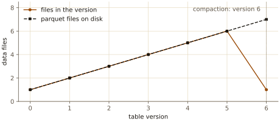

# Compact the small files that hourly appends leave

This chapter shows you how to count the data files a table holds, merge them into fewer files in Delta Lake, DuckLake and Iceberg, and say what each merge leaves on disk. The trouble starts with the loads. The pageviews table from the [first chapter](#first-table) is loaded once an hour into each of the three formats. Each load is a commit, and each commit writes its own data files. A data file is a file, Parquet in this book, that holds rows of a table.

## Hourly appends leave small files {#hourly-appends-leave-small-files}

Every commit that appends rows writes at least one data file. A table that takes one load an hour gets 24 data files a day, each holding one hour of rows, about 500 of them here. A query opens every file its filter does not skip, and each open costs time. The table's metadata also grows with every file it lists, because each format keeps a record of every data file that the current version uses. Many small files therefore cost reads and planning even when the total number of rows is modest.

The count of files is the number to watch, because it grows with time. File size matters too, but this book prints no file sizes, since a size in bytes changes from one run to the next. Counting files is also the honest check on a compaction. The rows should be the same before and after, and the file count should drop.

The fix is compaction. Compaction rewrites many small data files into fewer, larger ones. A compaction is a commit like any other. It writes the replacement files, lists them in the metadata, and leaves the old files on disk for as long as the table's history still refers to them. [Chapter 7](#expiry-and-cleanup) covers when those old files can go.

The three formats have three different calls for it. The table below shows what each one did to the six hourly files this chapter builds.

| Format | Call | Files before | Files after |
| --- | --- | --- | --- |
| Delta Lake | `optimize.compact()` | {{out:file-counts-before-after:files before compaction}} | {{out:file-counts-before-after:files after compaction}} |
| DuckLake | `ducklake_merge_adjacent_files` | {{out:compact-ducklake:data files before merge}} | {{out:compact-ducklake:data files after merge}} |
| Iceberg | `table.overwrite(table.scan().to_arrow_batch_reader())` | {{out:iceberg-rewrite-by-overwrite:data files before rewrite}} | {{out:iceberg-rewrite-by-overwrite:data files after rewrite}} |

The counts in the table are the ones each example printed. Each example loads the six hours of the cut, one load per hour, into a table with no partitions, so each format starts with one data file per load. The partitioned tables from [chapter 4](#partition-evolution) would behave differently, because each partition is compacted on its own in the formats that support it. This chapter keeps the table unpartitioned so that the count has one cause.

DuckLake's numbers need one more setting before they mean anything. The hourly loads here have about 500 rows each, above the row limit that [chapter 1](#what-a-table-format-adds) gives for inlining, so the default would write them as files anyway. The DuckLake example still attaches with inlining off, the setting that chapter explains, so that a file count never depends on how many rows a load happens to have.

**Working rule:** Count the data files of each table after each load, and schedule compaction from the rate at which files arrive and the file size your readers need. A load every hour gives 24 files a day per table, so a daily compaction is a reasonable first choice. This is a rule of thumb, not a measurement. Compact more often only when your own read times or file counts show that you need to.

## Compact with optimize.compact() {#compact-in-delta-lake}

Delta Lake is the first of the three formats in the table above. Its Python library, `deltalake`, puts compaction on the table's `optimize` property. Its `compact()` method rewrites the table's small data files into larger ones and returns a dictionary of metrics. The dictionary holds counts of the files added and removed, and size fields that this book does not print.

You load the six hours into a Delta table, one append each, then count the files the table lists, compact, and count again. Each count comes from the table's own list of files for its current version.

[Example: file-counts-before-after](../examples/file-counts-before-after.py)

The compaction changes the files, not the rows. The table lists {{out:file-counts-before-after:files before compaction}} data files before the call and {{out:file-counts-before-after:files after compaction}} after it, and a read of the current version returns {{out:file-counts-before-after:rows after compaction}} rows, the same rows as before, in fewer files.

The metrics the call returns count the same change from the library's side: {{out:file-counts-before-after:files added by compaction}} file added and {{out:file-counts-before-after:files removed by compaction}} files removed.

The compaction did not remove the old files. Read at the version from before the call, the table still returns all {{out:file-counts-before-after:rows at the version before compaction}} rows, because that version points at the old files. The directory holds {{out:file-counts-before-after:parquet files on disk after compaction}} Parquet files after the call, the six old ones and the new one. Delta Lake removes files that no retained version uses in a separate step called `vacuum`, which [chapter 7](#expiry-and-cleanup) shows. Until that step runs, a compaction adds files on disk rather than taking any away.

{{fig:files-live-and-on-disk}} follows the same six appends and the compaction version by version. The solid line counts the files each version lists, and the dashed line counts the Parquet files on disk after that version was written.

[Example: figure-files-live-and-on-disk](../examples/figure-files-live-and-on-disk.py)

Through the six appends the two lines coincide, because an append only adds a file and the newest version lists every file written so far. At the compaction, version {{out:figure-files-live-and-on-disk:compaction version}}, they part: the solid line falls to {{out:figure-files-live-and-on-disk:files in the compaction version}} file, and the dashed line climbs to {{out:figure-files-live-and-on-disk:parquet files on disk after the compaction version}}, because the files it replaced are still on disk.

Delta reads here go through the library's query builder, as every Delta read in this book does. Since the point is the file count, the rows are compared by count alone.

**Working rule:** Compact a Delta table on the schedule from the first section (daily for hourly loads), and check the file count afterwards. Read the retention rules in chapter 7 before you remove anything: a compaction adds a commit and leaves the old files in place, so it adds storage until the [vacuum](#vacuum-in-delta-lake) runs.

## Compact in DuckLake {#compact-in-ducklake}

DuckLake has compaction as a maintenance function that you call from SQL. The function is one call, and it returns a row that says what it did for each table it merges. The next part describes the function and the one case it skips.

### Merge adjacent files {#merge-adjacent-files}

`ducklake_merge_adjacent_files` takes a catalog, and optionally a table name and a schema name, which the call needs when the table is not in the `main` schema. Without a table name it merges the files of every table. The DuckLake documentation says the function can "merge multiple Parquet files into a single Parquet file that holds data inserted by multiple snapshots" ([DuckLake documentation: Merge Files](https://ducklake.select/docs/stable/duckdb/maintenance/merge_adjacent_files)). The merge also works without expiring snapshots, and it does not delete the old files at once. Both points matter for the rest of this chapter. Because the merge does not expire snapshots, every older snapshot still refers to the old files.

What does the merge leave for a snapshot from before it? The example below reads one. It attaches the catalog with inlining off, inserts the six hours one insert each, and calls the merge once. The table lives in the `wiki` schema, so the call names it. It reads the snapshot number before the merge, so it can read the table as it was at that point.

[Example: compact-ducklake](../examples/compact-ducklake.py)

The merge's result row says what it did: {{out:compact-ducklake:files merged}} files merged into {{out:compact-ducklake:files created}} file. The table lists {{out:compact-ducklake:data files after merge}} data file afterwards, down from {{out:compact-ducklake:data files before merge}}. The row also names the schema and the table, so a merge aimed at the wrong table shows before anything else is read.

The old snapshot still reads. A count taken at the snapshot before the merge returns {{out:compact-ducklake:rows at the snapshot before merge}} rows, the same count the current table returns. The Parquet files on disk number {{out:compact-ducklake:parquet files on disk after merge}}, the six the inserts wrote and the one the merge wrote. The six old files stay on disk until the [cleanup](#snapshots-keep-files-alive) in chapter 7 removes them.

The merge skips a file that has a [delete file](#delete-rows-iceberg-and-delta) attached. A delete file is a record of deleted rows, which DuckLake writes instead of rewriting the data file when rows are deleted. [Chapter 5](#corrections-and-merges) writes delete files in DuckLake, so this limit applies there. The DuckLake documentation names `ducklake_rewrite_data_files` as the call that rewrites those files, and its default `delete_threshold` is 0.95, which rewrites a file only when that share of its rows is deleted ([DuckLake documentation: Rewrite Files with Deletes](https://ducklake.select/docs/stable/duckdb/maintenance/rewrite_data_files)). The default is a value you should choose for your own data, not accept without a look.

**Working rule:** Run `ducklake_merge_adjacent_files` after the inserts for a period are done, and read the file count it returns. A merge does not remove deleted rows, so for a table with delete files, call `ducklake_rewrite_data_files` with a `delete_threshold` that you chose for that table, and check the result.

## Rewrite the table to compact it {#compact-iceberg-by-rewriting}

Compaction in Iceberg, at the pinned version of pyiceberg, is a rewrite by overwrite. This chapter rewrites the whole table, which is the case for an unpartitioned table. You read the table with a scan and overwrite the table with the rows it returns. The overwrite writes the rows as replacement data files, and the old files drop out of the current snapshot. This is the only compaction path in the book for Iceberg, and it is a workaround for a missing call, which the next part explains.

A rewrite is judged by what it leaves behind. The check below reads the table's files and rows after six appends and one overwrite, and reads a snapshot from before the rewrite.

[Example: iceberg-rewrite-by-overwrite](../examples/iceberg-rewrite-by-overwrite.py)

The data files fall from {{out:iceberg-rewrite-by-overwrite:data files before rewrite}} to {{out:iceberg-rewrite-by-overwrite:data files after rewrite}}, and a reader of the table sees the same {{out:iceberg-rewrite-by-overwrite:rows after rewrite}} rows, read the same way, from fewer files. The rewrite is one commit that adds two snapshots. The operations, in commit order, are six appends and then `delete` and `append`: the `delete` snapshot removes every data file from the table, and the `append` snapshot adds the rewritten files. The current snapshot moves once, so no reader sees the table empty, but the history keeps both snapshots. Deleting whole files in this way is the copy-on-write behaviour that [chapter 5](#corrections-and-merges) describes for Iceberg deletes.

The snapshot from before the rewrite still reads every row. The labels count snapshots up in commit order, so snapshot 6 is the last append before the rewrite. Read at that snapshot, the table still returns {{out:iceberg-rewrite-by-overwrite:snapshot 6 rows}} rows. The Parquet files on disk number {{out:iceberg-rewrite-by-overwrite:parquet files on disk after rewrite}}: the six old files and the one the rewrite wrote. [Chapter 7](#expiry-and-cleanup) covers how to expire the old snapshots and count what they still hold.

**Working rule:** Rewrite an Iceberg table by overwrite only when no other writer commits to the table during the rewrite. On an unpartitioned table, stream the scan as this example does. On a partitioned table, the scan must be read with `to_arrow()`, so the whole scan has to fit in the memory of the job. A streamed reader can be read only once: if the commit fails, build a new reader for the next attempt. Check the file count and the row count after each rewrite, and keep the snapshot from before it until you have checked the result.

### Why pyiceberg has no rewrite call {#why-no-rewrite-call}

The pyiceberg API documentation lists `overwrite` among its table operations ([PyIceberg API documentation](https://py.iceberg.apache.org/api/)). Its one sentence on compaction is in the note on fast appends, and it is about metadata: the page says that metadata compaction is planned. It says nothing about data files. Its only maintenance call is `expire_snapshots`, which chapter 7 covers. The source of pyiceberg {{version:pyiceberg}}, in `pyiceberg/table/__init__.py`, has no method that compacts or rewrites data files. Its write operations are `append`, `overwrite`, `delete`, `upsert`, `dynamic_partition_overwrite` and `add_files`. Every one except `add_files` writes data files, and `add_files` registers files that already exist and writes none. `dynamic_partition_overwrite`, and `overwrite` with an `overwrite_filter`, can replace the rows of one partition, so a partitioned table can be rewritten one partition at a time. A compaction is therefore a rewrite built from those operations.

The rewrite has a memory cost that the file counts do not show, and the way the scan is read decides it. `table.scan().to_arrow()` reads the whole current snapshot into one Arrow table in memory before the overwrite starts. The rewrite above passes `table.scan().to_arrow_batch_reader()` instead, and pyiceberg documents that a streamed overwrite is microbatched by `write.target-file-size-bytes`, so its memory stays bounded. Streaming works only on unpartitioned tables, which this chapter uses. A partitioned table has to be read with `to_arrow()`, so memory must hold all of its rows at once. The bound is pyiceberg's documented behaviour, not a measurement made here.

The rewrite also reads every file and writes every file, including the ones that were already large enough. A table whose files are mostly the right size gets no benefit from it. This is the reason to use it only when the file count has grown and the table fits in memory.

**Working rule:** Check the pyiceberg release notes at each upgrade for a compaction call, because a call would replace the overwrite rewrite in this chapter. Until then, treat the overwrite as a batch job, run it when no other writer is committing, and for a partitioned table budget memory for the whole scan.

## Check each compaction before you trust it {#check-each-compaction}

Between them, this chapter's examples print four things, and those four are what to check after any compaction you run. The first is the file count from the table's own listing. The second is the row count of the current version, which must match the count before the compaction. The third is the row count of a version or snapshot from before the compaction, which must still read. The fourth is the number of Parquet files under the table's location, which should exceed the file count by the number of old files that are waiting for cleanup.

The first two checks show that the compaction did what it claims and changed no rows. The third shows that the history still works, which matters for any reader that pins an older version. The fourth shows what the compaction left on disk. The first and the fourth come from different places, and the book's examples print both, so that a mismatch is visible in the output rather than hidden in one number. The fourth count is {{out:compact-ducklake:parquet files on disk after merge}} for the DuckLake table and {{out:iceberg-rewrite-by-overwrite:parquet files on disk after rewrite}} for the Iceberg table, each one more than the files that remain listed. A compaction that passes the first three checks is not at fault for a count like that. The extra files are the state that chapter 7 cleans up.

Each library has its own file listing. The Delta example counts the URIs of the current version, the DuckLake example asks its catalog for the table's files, and the Iceberg example counts the entries of the table's file inspection. The three numbers are read from metadata, so they do not depend on the directory listing, which is the second source. When the two disagree, stop and find out why before you run the next compaction.

When a check fails, stop the job and leave the table as it is. Do not run a second compaction to fix the first one, because each run is a commit, and the second run makes the history harder to read. Read the table's history for the commits in order, find the one that changed the row count, and decide from there. The state before the fault is easier to examine while the table still holds it.

**Working rule:** After every compaction, compare the row count with the count from before it, and read a version from before it. A compaction that changes the row count is a fault to fix before you run anything else on that table.

## What goes wrong in production {#compaction-production-failures}

**Storage grows before it shrinks.** Every compaction in this chapter writes replacement files and leaves the old ones on disk. The counts show it. After the DuckLake merge the table lists {{out:compact-ducklake:data files after merge}} data file while {{out:compact-ducklake:parquet files on disk after merge}} Parquet files sit on disk, and after the Iceberg rewrite the table lists {{out:iceberg-rewrite-by-overwrite:data files after rewrite}} while {{out:iceberg-rewrite-by-overwrite:parquet files on disk after rewrite}} sit on disk. A compaction that runs without an [expiry](#snapshots-keep-files-alive) step leaves the storage bill higher than before. Plan the expiry and the cleanup together with the compaction, and measure the disk after both. The sign is a disk that grows after each run while the table's row count and file count stay flat.

**Deleted rows stay until a rewrite handles them.** A DuckLake merge skips any file that has a delete file, as [the merge section](#merge-adjacent-files) shows. A table with deletes that is only merged keeps those files as they are. Use `ducklake_rewrite_data_files` for them, with a threshold you chose. Measure the rows before and after, because the merge alone will not show you that the deleted rows are still in the files. Watch for a count of files with delete files that stays the same after each merge.

**Concurrent writers are untested here.** This chapter's examples run one writer at a time and do not test a compaction that overlaps a commit. Test the overlap on your own engine, and schedule compaction in a window where no writer commits until you have that test. The Iceberg rewrite is the most exposed of the three, because it reads the whole table and then writes it back. A failed overlap would show as an error from the writer or from the compaction, and the book has not reproduced one.

**Too often costs commits, too seldom costs reads.** Each compaction is a commit, and each commit adds metadata. Compacting after every load doubles the commits per load. Compacting once a month lets small files build up for a month. The first shows as a commit count that climbs faster than the loads, the second as query times that rise with the file count. This is a trade-off you measure on your own table, not a rule the examples prove.

**A count goal is not a size goal.** A single very large file gives a reader less parallel work and fewer files to prune by file-level statistics. These examples aim at a file count and print no file sizes. This is a judgement about readers, and your readers' query times should set the target. Query times that get worse after a compaction that produced one very large file are the warning.

**Working rule:** Schedule compaction next to the expiry and cleanup, not apart from them. Run the four checks from [the check section](#check-each-compaction) after each run, and stop the schedule if the row count changes or if a concurrent writer fails.

## Decisions this chapter made {#compaction-decisions}

- Each format uses its own library's call, and no example here uses a DuckDB extension for Iceberg or Delta Lake. The reads and writes go through the Python libraries and through DuckDB's DuckLake support, so each count comes from the tool that wrote the files.
- The DuckLake example attaches with data inlining off. Turning inlining off makes every count a count of files, whatever the load size.
- The file counts come from each library's own file listing. The Parquet count on disk is a second check, and nothing prints file sizes.
- The tables are unpartitioned, so each count has one cause: the number of loads. The partitioned case is left to the chapter on partition evolution.
- Iceberg compaction is a rewrite by overwrite, because pyiceberg {{version:pyiceberg}} has no compaction call. The rewrite streams the scan, which pyiceberg allows for unpartitioned tables. The chapter names the workaround and the memory cost that remains for partitioned tables.
- Nothing in this chapter expires a snapshot or removes a file. [Chapter 7](#expiry-and-cleanup) does both, and this chapter's counts are the starting point for that work.
- The schedule in the working rule is a starting point. The book does not claim a best interval, because the right one depends on how fast a table's files arrive and how large its readers need them to be.
