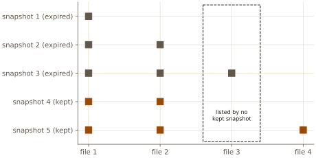

# Expire snapshots and remove unreferenced files

After this chapter you can expire old snapshots in each of the three formats, remove the data files that only those snapshots still listed, and show that a read of an expired snapshot fails.

[Compaction](#hourly-appends-leave-small-files) leaves the same kind of old file: the rewrites left the replaced files on disk, because older snapshots still list them. This chapter expires the old snapshots of `wiki.pageviews_hourly`, then deletes the files that no snapshot lists any more. Every example here uses the hour-02 correction from [the corrections chapter](#late-data-as-correction), written as an overwrite of that hour rather than as the upsert in its later section, because the overwrite leaves exactly one old file per format. Those old files stay until their snapshots are expired and their files are removed. Both steps run in each format, and each step is checked with a count rather than with a listing you have to trust.

## Snapshots keep files alive {#snapshots-keep-files-alive}

Every snapshot records which data files make up the table at that commit. [What a snapshot points to](#what-a-snapshot-points-to) covers how each format stores that list. The point for this chapter is that a commit that replaces rows does not delete the files it replaces. It writes files for the replacement rows, and the snapshots from before the commit still list the old ones, so time travel keeps working. A data file becomes an [orphan](#find-orphan-files) only when no snapshot you keep lists it.

Removing a file takes two steps in every format: expiry first, then cleanup. The Iceberg maintenance page gives the same order: expiry removes snapshots from the metadata, so time travel can't reach them, and "data files are not deleted until they are no longer referenced by a snapshot that may be used for time travel or rollback" ([Apache Iceberg, maintenance](https://iceberg.apache.org/docs/latest/maintenance/)). After expiry, cleanup deletes the files that no remaining snapshot lists.

`wiki.pageviews_hourly` takes three hourly appends, and then hour 02 is corrected by an overwrite of that hour. Each append writes one file. The overwrite writes a file with the corrected hour-02 rows, and it removes the old file from the current snapshot. The snapshot that appended the old file still lists it. Until that snapshot is expired, the old file cannot be deleted without breaking time travel to it. [Upserting a corrected hour](#upsert-corrected-hour) shows the other way to write the same correction, and it leaves the same kind of old file behind.

Each format has its own expiry call and its own cleanup call. The table lists them, and the rest of the chapter follows the same order for each format.

| Format | Expiry call | Expiry deletes files? | Cleanup call |
| --- | --- | --- | --- |
| Iceberg (pyiceberg) | `expire_snapshots().by_ids(...)` | No | None in the library: count and remove files yourself |
| Delta Lake (deltalake) | Version retention in `vacuum` | Yes, by `vacuum` | `vacuum` |
| DuckLake | `ducklake_expire_snapshots` | No | `ducklake_cleanup_old_files`, then `ducklake_delete_orphaned_files` |

**Working rule:** Decide which snapshots or versions a reader may still need, and expire the rest before you remove any file. Never remove a file that a snapshot you keep still lists, and check that claim with a count before you delete.

## Expire snapshots with pyiceberg {#expire-snapshots-in-iceberg}

In pyiceberg {{version:pyiceberg}}, `table.maintenance.expire_snapshots()` takes snapshot IDs, with `by_ids` for a list or `by_id` for one, or an `older_than` timestamp. It has no argument that keeps the last N snapshots. This chapter chooses IDs from the commit order, as the case does: the three hourly appends are the first three snapshots. The IDs themselves are random 64-bit numbers, so the example prints the labels "snapshot 1", "snapshot 2" and so on, in the same order.

The overwrite adds two snapshots, not one. pyiceberg writes a delete snapshot that removes the old file, then an append snapshot that adds the corrected rows. Snapshot 4 is the delete and snapshot 5 is the append. Expiring the three appends therefore leaves the overwrite in place, and that is the state the example checks.

The expiry call deletes no data files, so the example counts them itself, before and after: the distinct files that the snapshots list, and the files on disk that none of them lists. Watch the last count, which is where the replaced file shows up:

[Example: expire-iceberg-snapshots](../examples/expire-iceberg-snapshots.py)

Before the expiry, the table has {{out:expire-iceberg-snapshots:snapshots before expiry}} snapshots, and {{out:expire-iceberg-snapshots:data files referenced before expiry}} data files are listed by at least one of them. The current snapshot lists only {{out:expire-iceberg-snapshots:data files in the current snapshot}} of those files. The remaining one is the old hour-02 file, which snapshot 3 still lists. Reading the counts this way shows what the overwrite did: the current table is complete, and the history still holds the file the overwrite replaced.

Then the example expires snapshots 1 to 3, the three appends. The snapshots that remain are {{out:expire-iceberg-snapshots:remaining snapshots}}, the delete from the overwrite and its append. Afterwards {{out:expire-iceberg-snapshots:data files referenced after expiry}} data files are listed, and the old hour-02 file is no longer listed by any snapshot. It is still on disk: the example reports {{out:expire-iceberg-snapshots:unreferenced data files left on disk}} unreferenced file. The current table still returns {{out:expire-iceberg-snapshots:rows in the current snapshot}} rows, so the expiry changed no data a reader of the current table sees.

{{fig:snapshots-keep-files}} draws the same five snapshots as a grid. Each row is a snapshot and each column a data file, in the order the files were written, and a square marks a file that snapshot lists. The three expired rows are muted and the two kept rows are in the accent colour, and the row labels say which is which. Look at the column for file 3. Of the five snapshots, only snapshot 3 lists it, and the dashed frame marks the column that no kept row lists once the three muted rows expire.

[Example: figure-snapshots-keep-files](../examples/figure-snapshots-keep-files.py)

Before the expiry, {{out:figure-snapshots-keep-files:data files referenced before expiry}} files are listed. After it, {{out:figure-snapshots-keep-files:data files referenced after expiry}} are, and the one left over is {{out:figure-snapshots-keep-files:unreferenced after expiry}}. That file stays on disk until cleanup removes it, so the disk count still shows {{out:figure-snapshots-keep-files:unreferenced data files left on disk}} unreferenced file.

The last read fails. A scan of snapshot 3 after the expiry raises `ValueError`, which the output shows as "read snapshot 3: {{out:expire-iceberg-snapshots:read snapshot 3}}". A reader that pinned snapshot 3 before the expiry gets an error, not the old rows. The error, `Snapshot not found`, names the snapshot's ID, but it does not say that an expiry removed the snapshot. Your own logs have to record which expiry ran and which snapshot the report used.

**Working rule:** Expire Iceberg snapshots by ID, chosen from the commit order, and count the files each remaining snapshot lists before and after. Expect no disk space back from the expiry. pyiceberg removes metadata only, so the files it leaves behind stay on disk until you remove them yourself.

### Find orphan files after expiry {#find-orphan-files}

A file that no snapshot lists is an orphan. Spark and Java offer a `deleteOrphanFiles` action: it lists the table location, compares the files with the metadata and deletes the difference, and its default age interval is 3 days ([Apache Iceberg, maintenance](https://iceberg.apache.org/docs/latest/maintenance/)). The pyiceberg API page lists no orphan-file step, and the {{version:pyiceberg}} package has none either. Its maintenance methods expire snapshots ([PyIceberg API](https://py.iceberg.apache.org/api/)).

A helper in the book's shared module, [`examples/lib/lakehouse.py`](../examples/lib/lakehouse.py), `orphan_data_files`, makes the comparison by hand. It lists the Parquet files under the table location, subtracts the files that any remaining snapshot lists, and returns the rest. The output shows only the count, because the file names carry UUIDs. That count is the line that shows the expired file is still on disk.

A listing cannot tell an orphan from a file that a writer has written and not yet committed. The commit links the file to the table, and until then the file looks unreferenced. This is why the age guards matter. [DuckLake's `ducklake_delete_orphaned_files`](#expire-and-clean-up-in-ducklake) keeps young files by default, and the Spark action takes an age interval for the same reason. pyiceberg has no interval, so the check is yours to make. Deleting an orphan is a separate decision, and it belongs after the writers that could commit it have stopped.

**Working rule:** Count orphans by listing, and remove them only after you have confirmed that no writer can still commit them and no reader still uses a snapshot that lists them. In pyiceberg, nothing in the library makes that check for you.

## Vacuum a table with deltalake {#vacuum-in-delta-lake}

Delta Lake does not delete a file when a commit replaces it. A Delta commit that replaces a file adds a `remove` action to the log, a tombstone that says the file is no longer part of the table, and the file stays on disk. The protocol states that such files "can be lazily deleted by the vacuum command after a user-specified retention period (default 7 days)" ([Delta transaction log protocol, v4.4.1](https://raw.githubusercontent.com/delta-io/delta/v4.4.1/PROTOCOL.md)). The output in this section uses Delta's own version numbers, which start at 0.

Vacuum deletes the files whose tombstones are older than the retention. Until then, every version can be read, because every file it lists still exists. The Delta utility page states the cost: "The ability to time travel back to a version older than the retention period is lost after running vacuum" ([Delta Lake, VACUUM](https://docs.delta.io/delta-utility/)).

The case has three appends, which make versions 0 to 2, and then the hour-02 correction. The correction is a delete of that hour, which is version 3, followed by an append of the corrected rows, which is version 4. Version 2 still lists the old hour-02 file, and version 3 does not. Nothing has been removed yet, and that is the state the next section starts from.

The default retention in deltalake is 168 hours, seven days. A table can set its own in the `delta.deletedFileRetentionDuration` property, and `vacuum` uses that property when you pass no `retention_hours`. That property is the production setting. The library refuses a retention shorter than the property's value unless you turn off `enforce_retention_duration`. A longer retention needs no flag. The retention you choose is a promise about how far back history reaches. Every reader that opens an older version depends on it, and the next section shows the refusal and why this chapter's teaching run turns the check off.

**Working rule:** Keep vacuum's default retention, or set a longer one in `delta.deletedFileRetentionDuration`, so that every version a reader may request is still readable for that long after it stops being current. Go shorter only after you have checked the longest read and the longest write in your system, and only by turning `enforce_retention_duration` off as a deliberate, recorded decision.

### Dry run first {#vacuum-dry-run-first}

A dry run lists the files that a real vacuum would delete and deletes none of them. Run one before every vacuum, and compare its count with the table's history. The case is three appends, a delete in version 3 and an append in version 4. A short list can be checked by hand: here, each file in the list is one that a delete removed, and the one that matters is the delete in version 3. Two dry runs on that history ask vacuum, at two retentions, what it would delete:

[Example: vacuum-delta-dry-run](../examples/vacuum-delta-dry-run.py)

The table is at version {{out:vacuum-delta-dry-run:current version}}. With the default retention, the dry run lists {{out:vacuum-delta-dry-run:default retention, dry run lists}} files. The file that version 3 removed is too recent to be listed, and vacuum keeps it.

The next call sets the retention to zero, and deltalake refuses it with {{out:vacuum-delta-dry-run:zero retention without the flag}}. The library's own message says that the minimum retention is 168 hours, so the check protects the default.

The teaching run turns that check off with `enforce_retention_duration=False`. The code marks it as teaching-only, and production does not use it. With the check off, the dry run lists {{out:vacuum-delta-dry-run:zero retention, dry run lists}} file, and the real vacuum removes {{out:vacuum-delta-dry-run:zero retention, removed}} file, the old hour-02 file. Zero retention is the right setting for a demo, because it deletes the file at once. In production it is wrong: any reader that started before the vacuum, or that pinned an older version, loses the files it reads in the middle of a query. A short retention also deletes the files of a writer that has written but not yet committed. The Delta utility page warns that "tables can be corrupted when VACUUM deletes files that have not yet been committed" ([Delta Lake, VACUUM](https://docs.delta.io/delta-utility/)). The damage is to the table, not only to one read.

The read at the end shows what the vacuum cost. Version 0 still reads, with {{out:vacuum-delta-dry-run:rows in version 0}} rows, because every file it lists still exists. Version 2 fails with `ArrowInvalid`, shown as "read version 2: {{out:vacuum-delta-dry-run:read version 2}}". That class is the one the query engine raises for a failed Parquet read, and the message names the missing object. The read prints only the class. Read the message in your own logs before you decide that the table is damaged: it says which object is missing, and so whether a vacuum removed it.

A dry run is not a promise about the real run. A writer that commits between the two calls changes the table, and the real run works from the table state it finds. Treat the dry-run count as a check on what you expect, and read the real count next to it.

**Working rule:** Run vacuum as a dry run first and read the count. Remove files with a real run only when the count matches what you expected from the table's history, and keep the default retention unless you have checked the longest read in your system.

## Expire and clean up in DuckLake {#expire-and-clean-up-in-ducklake}

DuckLake keeps the physical files of a snapshot until that snapshot is expired. The DuckLake documentation says it this way: "Data can only be physically removed from DuckLake by expiring snapshots that refer to the old data" ([DuckLake, expire snapshots](https://ducklake.select/docs/stable/duckdb/maintenance/expire_snapshots)). The same page notes that expiry does not immediately delete the files it leaves unreferenced, and the cleanup page gives the second call ([DuckLake, cleanup of files](https://ducklake.select/docs/stable/duckdb/maintenance/cleanup_of_files)).

So DuckLake maintenance has two steps, and the example below runs both. `ducklake_expire_snapshots` takes a list of snapshot numbers in `versions`, or an `older_than` timestamp, but not both. `ducklake_cleanup_old_files` removes the files that expiry scheduled. With `older_than`, it removes only files scheduled before a given time. With `cleanup_all => true`, it removes every scheduled file, with no age check. Both steps support `dry_run`.

A third call, `ducklake_delete_orphaned_files`, handles files that no snapshot lists and that cleanup never scheduled, such as a file a writer left behind after a failed commit. Its default keeps a file that is still young, because a writer may be about to commit it. Its `cleanup_all` option removes such files regardless of age. The [catalog chapter](#catalog-production-failures) shows what that option does when a second catalog shares the data folder.

Attaching the catalog and creating the schema and the table through the helpers makes three snapshots before any rows: the attach makes snapshot 1, and the two `CREATE` statements make snapshots 2 and 3, labelled from 1 with setup included, as [chapter 2](#snapshot-decisions) does. Then the loading helper inserts hours 00 to 02, deletes hour 02 and inserts the corrected hour 02. That makes {{out:ducklake-expire-cleanup:snapshots before expiry}} snapshots, which the example labels "snapshot 1" up to the last one. The last is the corrected insert. The one before it is the delete, which drops the old hour-02 file. The insert before that, snapshot 6, is the last snapshot that lists it.

[Example: ducklake-expire-cleanup](../examples/ducklake-expire-cleanup.py)

The current snapshot lists {{out:ducklake-expire-cleanup:data files in the current snapshot}} data files, and one of them is copied to another name in the same folder, to stand in for a file a writer has written but not committed, as [Find orphan files](#find-orphan-files) describes. Then the steps run in order.

The expiry dry run lists {{out:ducklake-expire-cleanup:expiry dry run lists}} snapshots, which are all of them except the corrected insert. Because that insert stays, the table's current state is untouched. The real expiry leaves {{out:ducklake-expire-cleanup:remaining snapshots}}. The old hour-02 file is released at this step, because snapshot 6, the last snapshot that listed it, is expired.

The cleanup dry run lists {{out:ducklake-expire-cleanup:cleanup dry run lists}} file, the old hour-02 file. The DELETE matched every row in that file, and no delete file is scheduled with it, so the old file is the only one left to remove. The real cleanup removes {{out:ducklake-expire-cleanup:cleanup removed}} file.

The orphan check lists {{out:ducklake-expire-cleanup:orphans listed without cleanup_all}} orphans. The stray copy is still in the folder, because the default age check kept it: the file is only seconds old. The table still returns {{out:ducklake-expire-cleanup:rows in the current snapshot}} rows.

Last, the read of the delete, snapshot 7, fails: "read snapshot 7: {{out:ducklake-expire-cleanup:read snapshot 7}}". The class is the one DuckLake raises for a version it no longer has.

`cleanup_all => true` appears here because there is one catalog and no reader. Production uses `older_than` instead, with an age longer than the longest read, so that the cleanup removes only files that have been scheduled for long enough.

**Working rule:** Expire DuckLake snapshots first, then run each cleanup call as a dry run and then for real, in that order. Keep the default orphan check. Use `cleanup_all` only when one catalog owns the data folder and no reader still uses the files it removes, and use `older_than` otherwise.

## What goes wrong in production {#maintenance-production-failures}

**Removing a file that a reader still uses.** A query that started before a vacuum or a cleanup reads a file that is then gone, and the read fails partway through. You will see it as a read error that names a missing object, in a job that ran during a maintenance window. Schedule maintenance outside the long reads, and keep retention longer than the longest of them. A short retention can also delete a file that a writer has written and not yet committed, which corrupts the table rather than failing one read, so keep retention longer than the longest running write as well.

**Retention shorter than the longest query.** The seven-day default in Delta Lake is a margin, not a measurement. A dashboard that reads a version from a month ago is outside it. If a reader must see an older version, the retention has to cover it, or the reader has to copy the data first.

**Time travel that fails after maintenance.** The expired snapshot and the vacuumed version fail with `ValueError`, `ArrowInvalid` or `InvalidInputException`, depending on the format. [Iceberg](#expire-snapshots-in-iceberg) raises `ValueError`, and [Delta](#vacuum-dry-run-first) raises `ArrowInvalid`. [DuckLake](#expire-and-clean-up-in-ducklake) raises `InvalidInputException`. Any job that records a snapshot ID or a version number to read later fails the same way once that snapshot is expired. Keep your own record of which snapshot each report used, so that a rebuild starts from the data and does not depend on reading the old snapshot.

**A dry run that differs from the real run.** Two calls can disagree when a writer commits between them. The count from the dry run is what you expected, not what the real run will remove. Read the real count next to the dry-run count, and stop if they differ by more than you can explain.

**An audit that needs an older snapshot.** Some reports must reproduce a figure from months earlier. Expiry removes that ability for good, so decide the audit window before you expire, and keep the snapshots or the copied data the audit needs. Expiry is not a substitute for a copy.

**A cleanup that deletes a file another catalog needs.** `cleanup_all` and the orphan check with `cleanup_all` delete files by path. If a second catalog points at the same data folder, its live files look like orphans to the first catalog. The [catalog chapter](#catalog-production-failures) shows that failure in a temporary directory.

**Working rule:** Before you expire or clean up, list the readers, reports and audits that may open an older snapshot or version, and set the retention to cover the longest of them. Run each call as a dry run, compare its count with what you expected, and run the real call only when the two agree.

## Decisions this chapter made {#maintenance-decisions}

- Iceberg snapshots are expired by ID, chosen from the commit order. The chapter does not expire by age, so the result does not depend on the machine's clock, and pyiceberg {{version:pyiceberg}} has no keep-last-N argument.
- pyiceberg removes no files, so `expire-iceberg-snapshots` counts reachable and unreachable files and leaves the removal to the reader.
- The zero-retention run in `vacuum-delta-dry-run` is teaching-only. It is marked in the code, and production keeps the default retention.
- DuckLake expiry and cleanup are separate calls, and each runs as a dry run before the real call.
- `cleanup_all` appears only in single-catalog examples. The catalog chapter covers the case where it removes live files.
- Each example prints counts, stable labels and error class names, and no IDs, timestamps, file names or paths ([chapter 1](#first-table-decisions) gives the reason), and every number in the text comes from a bound output line or from the example's own construction.
- Every example keeps the table the earlier chapters built, so each count can be checked against the history the reader has seen.
- Each example builds its own temporary warehouse, so no output depends on an earlier example or on the machine that runs it.
- The stray copy in `ducklake-expire-cleanup` stands in for a file a writer has not committed, as [Find orphan files](#find-orphan-files) describes. That shows the orphan rule without waiting for a file to age, because the run takes seconds.
